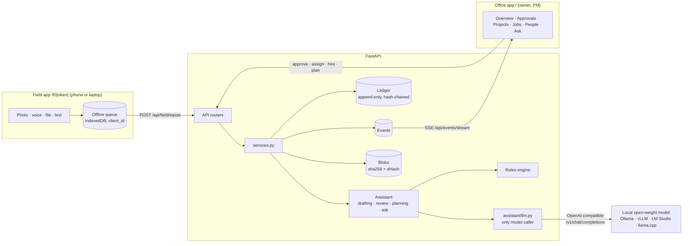

# Fieldbook MVP: architecture

One FastAPI process, one SQLite database, two web apps. The goal of the MVP is the whole loop working for real: a person in the field sends a photo, their Assistant drafts a report, the manager's Assistant checks it against the original files, a human approves, progress moves, and the record is locked.



## The rules the code keeps

| Rule | Where it is enforced |
| --- | --- |
| **The Assistant reads and judges; code does arithmetic.** The model returns observations (quantity as stated, stations, claims, missing evidence). `drafting.compute_delta` turns them into progress; the model never writes a progress number. Numbers a person typed beat the model's reading, and model stations must parse as stations. | `assistant/drafting.py`, `progress.py` |
| **Only humans approve.** Approval endpoints need a manager's session link; field links get 401. The ledger records which human acted. | `api/deps.office_user`, `services._require_manager` |
| **Approved history is locked.** Database triggers reject `UPDATE`/`DELETE` on `ledger_entries`. Each entry's hash covers the previous hash, so editing history breaks the chain and `fieldbook verify` reports where. Corrections are amendment entries with a required reason; the original stays readable. | `db.py`, `ledger.py`, `services.amend_entry` |
| **Progress comes only from the ledger** (approved) and submitted reports (pending, the hatched part of the bar). Nothing else moves it. | `progress.compute` |
| **Nothing invented.** A plan quantity the model proposes that isn't printed in the documents is blanked, and a blank quantity blocks plan approval until someone types it in. Ask answers only cite sources that exist. | `assistant/planning.py`, `assistant/ask.py`, `services.approve_plan` |
| **Evidence everywhere.** Every input keeps its original file; every review chip opens it. | `storage.py`, `/api/files/{id}` |

## Components

| Module | Job |
| --- | --- |
| `models.py` | Tables: orgs, people, tokens, projects, documents, plan items, jobs, inputs, reports, ledger entries, events, usage log. `org_id` is on the top-level rows, ready for multi-tenancy. |
| `services.py` | Every state change (hire, remove, role change, assign, add input, submit, approve, request changes, ask, amend, project setup). API and seed both call these. Each emits the events the office app shows live. |
| `assistant/rules.py` | Deterministic reading: stations (`12+00`), quantities by unit, sheet ranges (`W-38 to W-41` = 4 sheets), checklist evidence. Runs alone without a model, and always cross-checks the model. |
| `assistant/llm.py` | The only model caller, over the OpenAI-compatible Chat Completions API (`/v1/chat/completions`), so Ollama, vLLM, LM Studio, llama.cpp and LocalAI all work. Asks for one JSON object: `response_format: json_schema` (strict) when the server supports it, plain JSON mode when it doesn't (detected and remembered), and the schema is in the prompt either way because small models follow it better. Strips `<think>` blocks and code fences, validates with pydantic, retries once with the validation error, drops photos for models that reject images. Logs tokens and failures to `usage_log`. Any failure returns `None` and the rules engine takes over. |
| `assistant/drafting.py` | Inputs → draft report. Sends message text, voice transcripts and PDF text (clipped to `FIELDBOOK_LLM_MAX_INPUT_CHARS`) plus up to `FIELDBOOK_LLM_MAX_IMAGES` photos downscaled to 896 px. |
| `assistant/review.py` | The manager's review brief. Code checks: reused photos (perceptual hash, Hamming ≤ 6, catches re-saved copies), history ("320 LF today vs. this crew's usual 200 LF"), station overlap, plan overrun, checklist. The model adds what the photos actually show, as warnings prefixed "Assistant:". Groups each report as routine, needs attention or flagged. |
| `assistant/planning.py` | Scope PDFs → proposed plan items with sources. Extracts the text layer, ranks pages by how many quantity lines they hold, and sends the best pages that fit the budget, each labelled `=== file p.N ===`. Says in the plan notes what was skipped (scanned pages, pages over budget, non-PDFs). |
| `assistant/ask.py` | Q&A across jobs from a computed snapshot, with sources filtered to ones that exist. |
| `api/stream.py` | Server-sent events read from the `events` table, so they work across worker processes and resume from `Last-Event-ID`. |
| `web/app.*` | The office app: a sidebar layout with Overview (KPIs, what needs attention, activity), Approvals (queue grouped flagged / needs attention / routine, evidence, the Assistant's review, approve / request changes / ask), Projects (jobs, team, locked history with amendments, plan review), Jobs, People (each person's Assistant, jobs, role, field link) and Ask. Renders `/api/office` and refreshes on live events. Light and dark, works on a phone. |
| `web/field.*` | The worker app: job header, today's draft, thread, composer, offline queue. Shares `app.css`. |

## Report lifecycle

```
draft ──submit──▶ submitted ──approve──▶ approved  (ledger entry, progress moves, locked)
  ▲                   │
  └──── new inputs ◀──┴──request changes──▶ changes_requested
```

New inputs go to the person's open report for that job (a draft, or one sent back). Each input triggers a background re-draft. Submitting re-drafts once more, then runs the review.

## Security model (MVP)

- **Links instead of passwords.** The owner and PMs open a login link (session cookie, `HttpOnly`, `SameSite=Lax`, `Secure` on https). Everyone else gets a field link. Only SHA-256 hashes of tokens are stored. Removing a person revokes their links.
- **Scope:** field links see only that person's jobs, inputs and files. Contractors get the same, which is what "own scope only" means. Office endpoints check that every id belongs to the caller's org.
- **Not yet:** rate limiting, link expiry, audit of reads, SSO. Treat the MVP as an internal pilot behind HTTPS.

## Decisions taken (2026-10-22)

| # | Decision | Reason |
| --- | --- | --- |
| B1 | Python 3.12+, FastAPI, SQLAlchemy 2, SQLite (WAL), pydantic, pytest, ruff, uv. | Same boring stack as the Takeoff repo; nothing to learn twice. Postgres needs only a URL change plus the trigger SQL already in `db.py`. |
| B2 | ~~Claude API for drafting, review, plans and Ask.~~ Replaced by B8 on 2026-10-23. | — |
| B3 | A rules engine is a first-class Assistant, not a mock. | The MVP runs and tests run with no model at all, and the model's numbers get a deterministic cross-check. |
| B4 | Ledger integrity uses database triggers plus a hash chain, not just application code. | "Locked for good" has to survive application bugs. The hash chain also makes tampering at the file level detectable. |
| B5 | Live updates use SSE polling the events table every second. | It's correct across processes and simple. Replace it with Postgres `LISTEN/NOTIFY` when there are many open offices. |
| B6 | Voice notes are transcribed in the browser (Web Speech API) and sent as text with the audio. | The models read text and images, not audio. Server-side speech-to-text (e.g. whisper.cpp) is the upgrade path (see below). |
| B7 | The project plan uses equal job weights for project %. | The brief mentions weights; they need a UI first. |

## Decisions taken (2026-10-23)

| # | Decision | Reason |
| --- | --- | --- |
| B8 | The Assistant runs on self-hosted open-weight models through the OpenAI-compatible API. Default server Ollama; suggested model a small vision model such as `qwen2.5vl:7b` (or `gemma3:12b`). | No paid API key. One API covers Ollama, vLLM, LM Studio and llama.cpp, so the model can change with an environment variable. |
| B9 | Plans are read from the PDF text layer, ranked and clipped to a character budget, instead of sending whole PDFs. | Local models have small context windows and can't take PDFs directly. Scanned pages are named in the plan notes so nobody assumes they were read. |
| B10 | Temperature 0, one JSON object per call, schema enforced by the server when possible and always restated in the prompt; one retry on invalid JSON, then the rules engine. | Small models drift from a schema more often than large ones; failing over to rules keeps every report moving. |
| B11 | The office is a standard business layout (sidebar, KPI cards, approvals queue, tables, drawers), replacing the illustrated office scene. | The owner asked for a professional UI. Tables and a queue scale to many people and projects; the scene didn't. |

## Known limits and the path past them

| Limit now | Next step |
| --- | --- |
| Single process; the ledger lock is in-process (unique `seq` and `prev_hash` stop forks across processes, at the cost of a retry). | Postgres with `SELECT … FOR UPDATE` on the chain head; run the Assistant calls on a worker queue (RQ or Celery) instead of FastAPI background tasks. |
| Files on local disk. | S3-compatible storage behind `storage.save_blob`/`read_blob`; signed URLs for evidence. |
| Voice transcripts depend on the phone's browser. | Server-side transcription, then pass the text to drafting. |
| Plan reading uses the PDF text layer only; scanned sheets are skipped (and named in the plan notes), and big sets are clipped to the best pages that fit the budget. | OCR (Tesseract) for scanned pages; read big sets in several calls by discipline; render sheets to images for a vision model; reuse Takeoff's sheet ingest. |
| The local-model path is tested against a simulated OpenAI-compatible server, not real weights; quality depends on the model you pull. | Keep a small set of real field messages, photos and bid forms with expected readings, and score each candidate model on them before switching. |
| No schema migrations yet (`create_all`). | Add Alembic before the first real customer data. |
| Outlook and SharePoint/OneDrive are not connected. | Email-in per project address; Graph API connector for folders. |

## Running it

```sh
make setup      # uv sync
make test       # ruff + tests
make demo       # sample company + server; open the owner login link it prints
```

Set `FIELDBOOK_LLM_MODEL` (and `FIELDBOOK_LLM_BASE_URL` if the server isn't Ollama on its default port) to switch the Assistant from the rules engine to a local model. `fieldbook doctor` checks the server and the models; `fieldbook usage` shows model calls and tokens by purpose.
