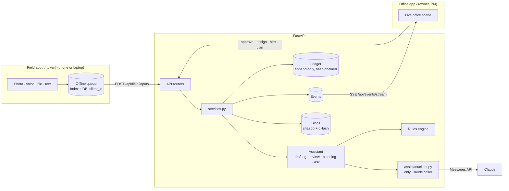

# Fieldbook MVP: architecture

One FastAPI process, one SQLite database, two web apps. The goal of the MVP is the whole loop working for real: a person in the field sends a photo, their Assistant drafts a report, the manager's Assistant checks it against the original files, a human approves, progress moves, and the record is locked.



## The rules the code keeps

| Rule | Where it is enforced |
| --- | --- |
| **The Assistant reads and judges; code does arithmetic.** Claude returns observations (quantity as stated, stations, claims, missing evidence). `drafting.compute_delta` turns them into progress; Claude never writes a progress number. | `assistant/drafting.py`, `progress.py` |
| **Only humans approve.** Approval endpoints need a manager's session link; field links get 401. The ledger records which human acted. | `api/deps.office_user`, `services._require_manager` |
| **Approved history is locked.** Database triggers reject `UPDATE`/`DELETE` on `ledger_entries`. Each entry's hash covers the previous hash, so editing history breaks the chain and `fieldbook verify` reports where. Corrections are amendment entries with a required reason; the original stays readable. | `db.py`, `ledger.py`, `services.amend_entry` |
| **Progress comes only from the ledger** (approved) and submitted reports (pending, the hatched part of the bar). Nothing else moves it. | `progress.compute` |
| **Nothing invented.** A plan quantity not found in the documents stays blank and blocks plan approval until someone types it in. | `assistant/planning.py`, `services.approve_plan` |
| **Evidence everywhere.** Every input keeps its original file; every review chip opens it. | `storage.py`, `/api/files/{id}` |

## Components

| Module | Job |
| --- | --- |
| `models.py` | Tables: orgs, people, tokens, projects, documents, plan items, jobs, inputs, reports, ledger entries, events, usage log. `org_id` is on the top-level rows, ready for multi-tenancy. |
| `services.py` | Every state change (hire, remove, role change, assign, add input, submit, approve, request changes, ask, amend, project setup). API and seed both call these. Each emits the events the office animates. |
| `assistant/rules.py` | Deterministic reading: stations (`12+00`), quantities by unit, sheet ranges (`W-38 to W-41` = 4 sheets), checklist evidence. Runs alone without Claude, and always cross-checks Claude. |
| `assistant/client.py` | The only Claude caller. Model, effort and max tokens come from settings. Structured JSON output validated by pydantic; server-side refusal fallback (`fallbacks: "default"`); typed error handling; one `usage_log` row per call. Any failure returns `None` and the rules engine takes over. |
| `assistant/drafting.py` | Inputs → draft report. Sends message text, voice transcripts, up to 6 downscaled photos and small PDFs to Claude. |
| `assistant/review.py` | The manager's review brief. Code checks: reused photos (perceptual hash, Hamming ≤ 6, catches re-saved copies), history ("320 LF today vs. this crew's usual 200 LF"), station overlap, plan overrun, checklist. Claude adds what the photos actually show. Groups each report as routine, needs attention or flagged. |
| `assistant/planning.py` | Scope PDFs → proposed plan items with sources. Claude reads the PDFs directly (≤ 550 pages, ≤ 24 MB per request); the rules engine reads bid-form lines. |
| `assistant/ask.py` | Q&A across jobs from a computed snapshot, with sources. |
| `api/stream.py` | Server-sent events read from the `events` table, so they work across worker processes and resume from `Last-Event-ID`. |
| `web/office.*` | The owner's office. It renders `/api/office`, then animates live events (photo packets, folders to the in-tray, tags flying to desks). |
| `web/field.*` | The worker app: job header, today's draft, thread, composer, offline queue. |

## Report lifecycle

```
draft ──submit──▶ submitted ──approve──▶ approved  (ledger entry, progress moves, locked)
  ▲                   │
  └──── new inputs ◀──┴──request changes──▶ changes_requested
```

New inputs go to the person's open report for that job (a draft, or one sent back). Each input triggers a background re-draft. Submitting re-drafts once more, then runs the review.

## Security model (MVP)

- **Links instead of passwords.** The owner and PMs open a login link (session cookie, `HttpOnly`, `SameSite=Lax`, `Secure` on https). Everyone else gets a field link. Only SHA-256 hashes of tokens are stored. Removing a person revokes their links.
- **Scope:** field links see only that person's jobs, inputs and files. Contractors get the same, which is what "own scope only" means. Office endpoints check that every id belongs to the caller's org.
- **Not yet:** rate limiting, link expiry, audit of reads, SSO. Treat the MVP as an internal pilot behind HTTPS.

## Decisions taken (2026-10-22)

| # | Decision | Reason |
| --- | --- | --- |
| B1 | Python 3.12+, FastAPI, SQLAlchemy 2, SQLite (WAL), pydantic, pytest, ruff, uv. | Same boring stack as the Takeoff repo; nothing to learn twice. Postgres needs only a URL change plus the trigger SQL already in `db.py`. |
| B2 | Claude `claude-opus-5-5` at effort `medium` for drafting and review, `high` for plan reading, `low` for Ask. Server-side refusal fallback on. | Drafting and review are short structured reads. Plan reading is the hardest call. Ask is chat. All of this is configurable. |
| B3 | A rules engine is a first-class Assistant, not a mock. | The MVP runs and tests run with no API key, and Claude's numbers get a deterministic cross-check. |
| B4 | Ledger integrity uses database triggers plus a hash chain, not just application code. | "Locked for good" has to survive application bugs. The hash chain also makes tampering at the file level detectable. |
| B5 | Live updates use SSE polling the events table every second. | It's correct across processes and simple. Replace it with Postgres `LISTEN/NOTIFY` when there are many open offices. |
| B6 | Voice notes are transcribed in the browser (Web Speech API) and sent as text with the audio. | Claude reads text and images, not audio. A server-side speech-to-text service is the upgrade path (see below). |
| B7 | The project plan uses equal job weights for project %. | The brief mentions weights; they need a UI first. |

## Known limits and the path past them

| Limit now | Next step |
| --- | --- |
| Single process; the ledger lock is in-process (unique `seq` and `prev_hash` stop forks across processes, at the cost of a retry). | Postgres with `SELECT … FOR UPDATE` on the chain head; run the Assistant calls on a worker queue (RQ or Celery) instead of FastAPI background tasks. |
| Files on local disk. | S3-compatible storage behind `storage.save_blob`/`read_blob`; signed URLs for evidence. |
| Voice transcripts depend on the phone's browser. | Server-side transcription, then pass the text to drafting. |
| Plan reading takes PDFs only; plan sets over 550 pages fall back to the bid-form text. | Split large sets by discipline; read sheets in batches with the Message Batches API; reuse Takeoff's sheet ingest. |
| No schema migrations yet (`create_all`). | Add Alembic before the first real customer data. |
| Outlook and SharePoint/OneDrive are not connected. | Email-in per project address; Graph API connector for folders. |

## Running it

```sh
make setup      # uv sync
make test       # ruff + 29 tests
make demo       # sample company + server; open the owner login link it prints
```

Set `ANTHROPIC_API_KEY` (or sign in with `ant auth login`) to switch the Assistant from the rules engine to Claude. `fieldbook usage` shows token use by purpose.
